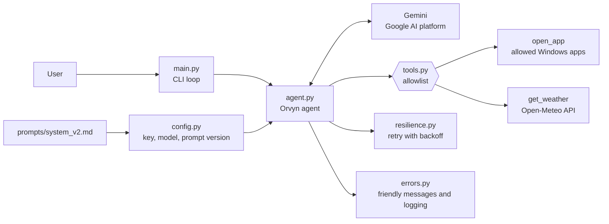
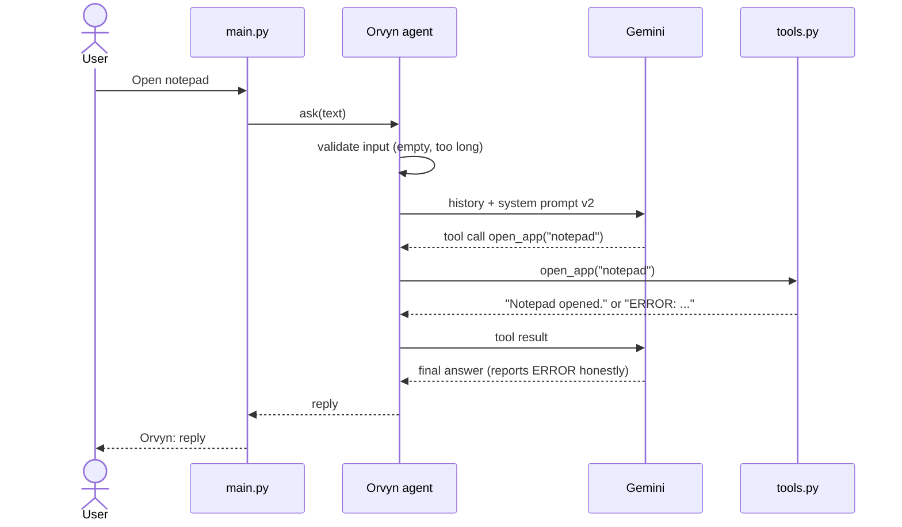
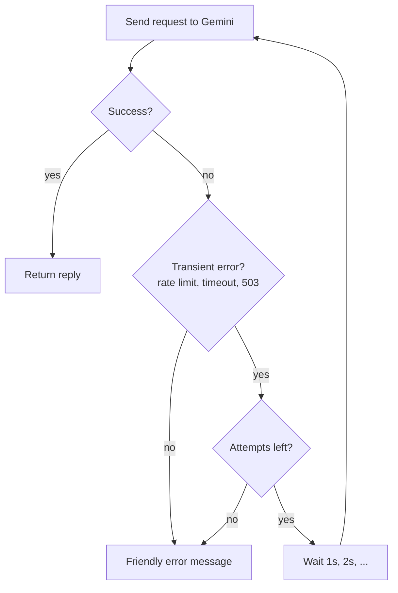
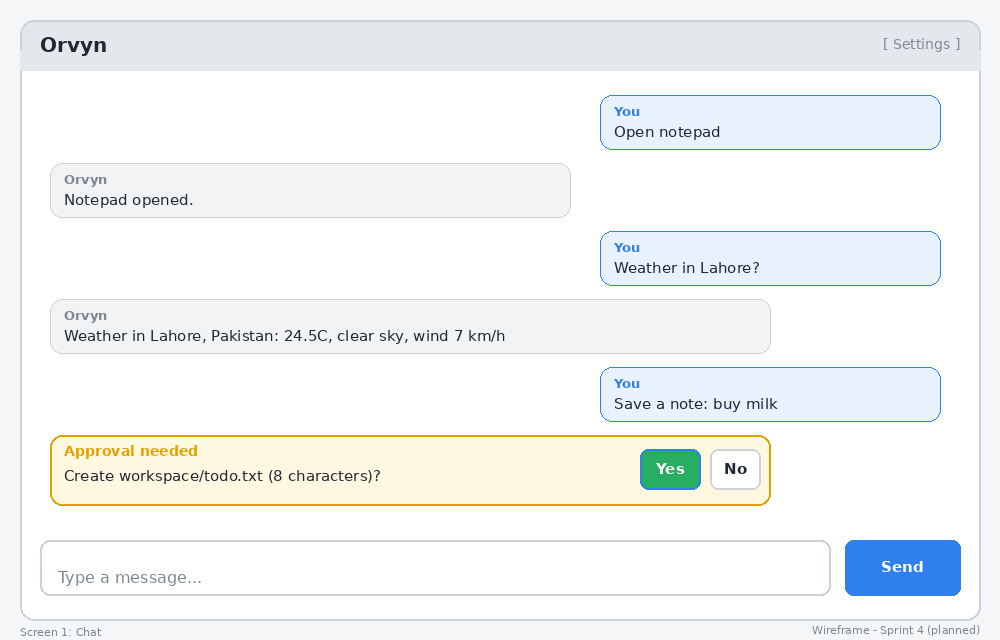
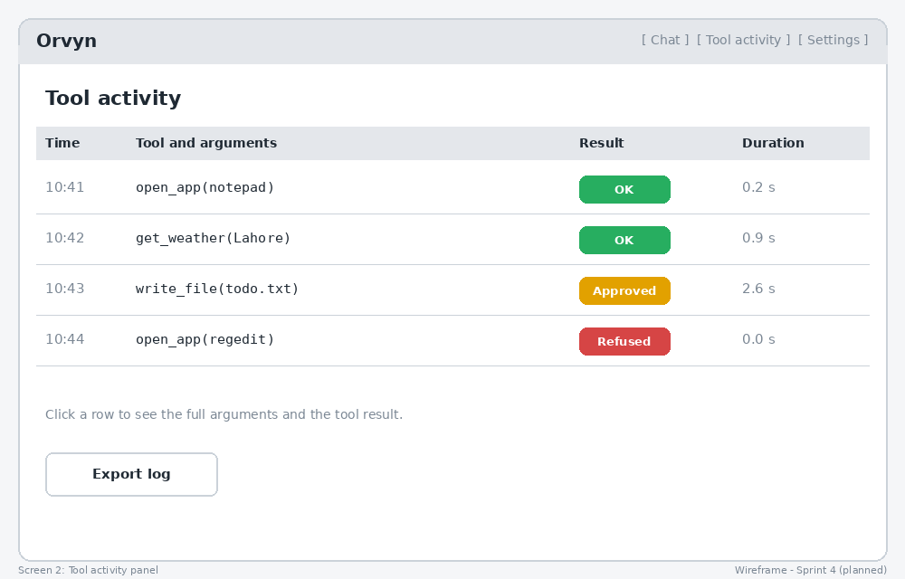
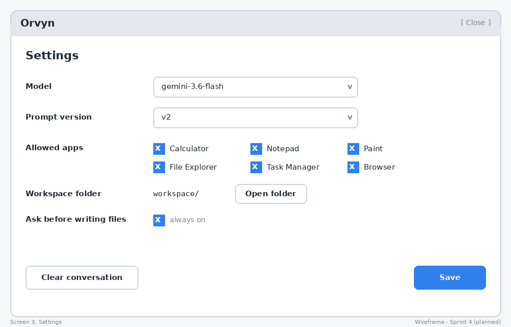

# Orvyn Architecture (Sprint 2)

Diagrams are written in Mermaid, so GitHub renders them directly.

## 1. Components



**Rationale:** the agent is the only module that talks to Gemini; tools, retry and error handling are separate so each can be tested without the API.

## 2. Tool-use sequence



**Rationale:** tools return text instead of raising, so the model sees failures and can report them instead of claiming success.

## 3. Retry and error flow



**Rationale:** temporary problems should not force the user to retype; bad API keys and unknown errors fail fast.

## 4. UI wireframes for Sprint 4

Image files are in `docs/wireframes/`.







Text versions of the same screens:

### Screen 1: Chat
```
+--------------------------------------------------+
| Orvyn                              [Settings]    |
+--------------------------------------------------+
| You:   Open notepad                              |
| Orvyn: Notepad opened.                           |
| You:   Weather in Lahore?                        |
| Orvyn: Weather in Lahore, Pakistan: ...          |
|                                                  |
+--------------------------------------------------+
| [ Type a message...                    ] [Send]  |
+--------------------------------------------------+
```

### Screen 2: Tool activity panel
```
+--------------------------------------------------+
| Tool activity                                    |
+--------------------------------------------------+
| 10:41  open_app(notepad)        OK     0.2 s     |
| 10:42  get_weather(Lahore)      OK     0.9 s     |
| 10:43  open_app(regedit)        REFUSED          |
+--------------------------------------------------+
```

### Screen 3: Settings
```
+--------------------------------------------------+
| Settings                                         |
+--------------------------------------------------+
| Model:           [ gemini-3.6-flash  v ]         |
| Prompt version:  [ v2 v ]                        |
| Allowed apps:    [x] Calculator [x] Notepad ...  |
| [Clear conversation]                [Save]       |
+--------------------------------------------------+
```
